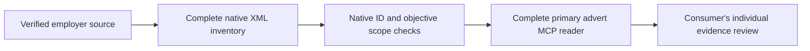

# Original Personio primary adverts

Version 0.4.20 adds one read-only tool, `shared_personio_detail`. Pass an exact advert identified on a verified employer's own career page or native Personio inventory. The tool does not discover employers or supply a default tenant.

```json
{"job_url":"https://verified-employer.jobs.personio.de/job/123456"}
```

The existing XML inventory and process-local snapshot tools remain the complete-feed route. Their German/English description variants share native IDs. XML excludes the separately configured **About us** section; the new reader closes that primary-advert gap without using a browser or application interface.

## Independent content representations

The original parser reads anonymous first-party HTML as data. It requires a unique native main area, primary description, public title/header, canonical URI and matching JobPosting identifier. The URI job ID, native compound job/platform-company identifier and tenant hostname remain distinct. A source canonical URI cannot change employer or job identity. Account, apply, credential, arbitrary filter and unrelated-origin routes are refused before transport. There is no redirect-following or cookie/session client.

Complete native primary HTML/text, native sections, separate About us context, header facts and a whitelisted public JobPosting projection are returned separately. Schema descriptions can be summaries and never replace the primary. Source form/script/media controls and nonpublic hydration state are excluded. Media-only requirements remain unverified; no images, scripts or application pages are requested. Missing or competing content fails explicitly instead of returning an empty successful advert.

The canonical description locale and HTML document/display language remain source facts. They can differ: one qualified German advert has an English document language. Neither field establishes working-language requirements or applicant fluency. Source `datePosted`, contract/location fields and weekly hours likewise establish no verified original instant, exact student contract, Germany-based remote permission or individual fit.

## End-to-end use



Preserve every native record, source limit and locale variant without counting translations as jobs. Fetch the complete primary advert for surviving records; retain company context alongside the role. Human review and application controls belong to the consuming application. The source server always leaves human-review and country/week coverage claims false.

The dated qualification used four actual primary adverts linked by the native board: one German and three English adverts whose default German XML descriptions were empty. All primary sections and separate company blocks were captured through the unified MCP; four invalid application/filter/origin/credential routes were refused. These are format and transport tests, not a national/employer census or applicant assessment. Public proof contains aggregates and hashes, with no advert corpus or applicant data.

Primary references: [Personio XML integration and omitted company context](https://support.personio.de/hc/en-us/articles/207576365-Integrate-jobs-from-Personio-into-your-website-via-XML), [independent career-page and job-language logic](https://support.personio.de/hc/en-us/articles/4409392549777-Summary-of-Personio-career-page-language-logic).
